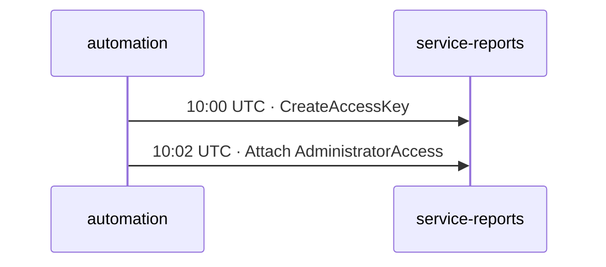

# Security engineering portfolio

[](https://github.com/Keatonmott/cybersecurity-portfolio/actions/workflows/tests.yml)

Three Python labs examine cloud identity changes, document ownership, and trust in retrieved text. Each includes synthetic inputs, a working control, and the evidence behind its result. [Browse the evidence](evidence/README.md)

## Two minutes to administrator access

On January 10, the `automation` identity created an access key for a reporting account, then granted that account full administrative access. The cloud lab asks which changes an analyst should investigate.



The detector flagged this pair because both events succeeded, named the same target user, and fell within ten minutes. The other four records show two near misses. One pair names different users. The other arrives twenty minutes apart. An approved provisioning job could also trigger the rule, so the next step is to compare the grant with the change request. [Six source events](projects/cloud_security_lab/fixtures/events.jsonl) · [Detection rule](projects/cloud_security_lab/detect.py) · [Analyst report](projects/cloud_security_lab/report.md)

## Case studies

| Project | What the fixtures show | Evidence |
| --- | --- | --- |
| [Cloud posture and detection](projects/cloud_security_lab/README.md) | Three configuration findings cover public storage, wildcard permissions, and disabled logging. The corrected snapshot clears all three checks. | [Original findings](evidence/cloud-risky.json) · [After remediation](evidence/cloud-safe.json) |
| [Document API authorization](projects/secure_api/README.md) | Across seven reads, owners receive their documents, cross-owner and missing documents return 404, and unrecognized identities receive 401. | [Access decisions](evidence/api-authorization.json) |
| [AI application security](projects/ai_security/README.md) | A deterministic reader discloses a synthetic secret on all three marked documents. A reader that extracts only the requested fact discloses it on none and answers both ordinary documents correctly. | [Cases and results](projects/ai_security/report.md) |

## Reproduce the alert

From the repository root, run the detector with Python 3.10 or newer. The labs use the standard library and run offline.

```sh
python -m projects.cloud_security_lab.detect projects/cloud_security_lab/fixtures/events.jsonl
```

Look for `IDENTITY-001` and its two source records in the JSON output. [Expected output](evidence/identity-alerts.json)

Run the full regression suite and rebuild all five reports.

```sh
python -m unittest discover -s tests -v
python -m tools.build_evidence
```
